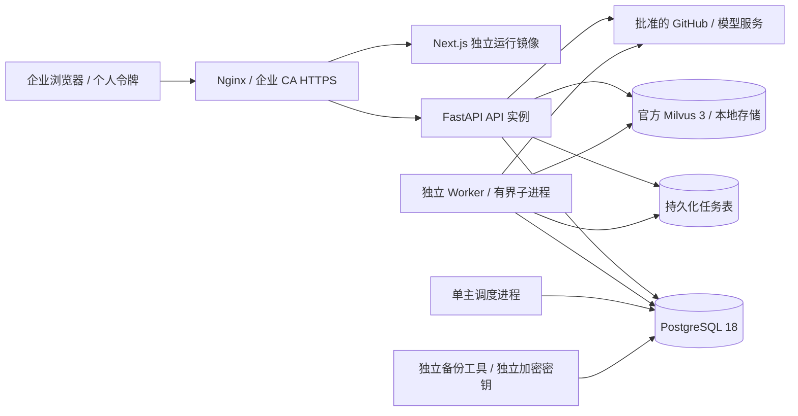

# 企业内部私有部署与运维

[返回项目首页](../README.md) · [本轮验收与上线门槛](enterprise_validation.md) · [安全边界](architecture/security.md)

本交付面向**一个企业内部团队**，使用 DevWorkbench 个人访问令牌登录。owner 是该实例的全局管理员，成员由仓库授权隔离；这不是面向互不信任企业的 SaaS 租户架构。没有公司服务器、域名和证书时，可以完成隔离环境验收，不能替代真实部署验收。

当前版本用于隔离验收。接入正式仓库和业务流量前，先满足[上线门槛](enterprise_validation.md#安全与放行条件)。

## 部署结构



只有网关发布 80/443 端口。PostgreSQL、Milvus 使用内部网络；API 不挂载 Docker socket。生产 API 不内嵌后台 Worker，增加 API 副本不会增加调度器或重复投递业务任务。Milvus 使用官方的内嵌 etcd、本地存储方案，原第三方对象存储镜像已移除。

PostgreSQL 直接以 Alpine 官方镜像的 postgres 用户（UID/GID 70）运行，并移除容器 Linux capabilities。项目构建的 PostgreSQL 镜像移除了运行文件系统中的 `gosu`。使用 Compose 管理的新数据卷。接入已有卷前先备份，并检查数据目录是否归该用户所有。

这是单机持久化部署起点，不包含主机故障下的自动切换。起步可规划 8 vCPU、16 GB 内存和加密 SSD，并为数据库、上传文件、备份临时空间和镜像留余量；这是资源规划建议，不是容量压测结论。正式容量必须使用公司实际文档、用户数、模型延迟和并发目标验收。

## 官方来源与构建

| 内容 | 允许的来源与校验 |
| --- | --- |
| Docker Engine / Compose | [Docker 官方安装说明](https://docs.docker.com/engine/install/)；不要执行来源不明的一键脚本 |
| Python 包 | `https://pypi.org/simple`，归档域 `files.pythonhosted.org`；生产锁固定 124 个版本和匹配 Linux/amd64、CPython 3.12 的 wheel SHA-256 |
| Node 包 | `https://registry.npmjs.org`；`npm ci --ignore-scripts` 使用锁文件 integrity |
| 基础镜像 | Docker Official Images 的 Python、Node、PostgreSQL、Nginx，以及 Milvus 官方 `milvusdb/milvus`；生产默认固定摘要 |
| 系统包 | Debian、Alpine、Ubuntu 官方仓库，备份客户端使用 PostgreSQL 官方签名仓库 |

`python scripts/check_sources.py` 会检查仓库中的远程 npm 归档来源和部署镜像发布者。锁文件减少构建漂移，不保证发布者代码绝对安全。依赖升级需重新构建、扫描并运行回归；不得通过换第三方镜像站来绕过失败。

Compose 使用固定摘要的官方基础镜像构建项目镜像。构建会检查 Debian 和 Alpine 的 zlib 安全版本，以及 Milvus 基础镜像中 Ubuntu APT 的安全版本。安全更新发布后，使用 `build --pull --no-cache` 重新获取官方软件包，并扫描实际准备发布的镜像。

生产入口是 [compose.production.yml](../deploy/compose.production.yml)。以下命令在项目根目录执行，示例使用 Linux shell：

```bash
python scripts/init_production.py --origin https://codepilot.corp.example
chmod 600 deploy/production.env
# 在 production.env 填入公司批准的模型密钥，核对外发主机白名单和额度。
# 将企业 CA 签发的证书及完整链放入 deploy/tls/tls.crt，私钥放入 tls.key。
# 网关以 UID/GID 101 运行：私钥应仅允许该服务身份读取。
chown 101:101 deploy/tls/tls.key
chmod 600 deploy/tls/tls.key

docker compose --env-file deploy/production.env -f deploy/compose.production.yml build --pull
docker compose --env-file deploy/production.env -f deploy/compose.production.yml up -d --wait
docker compose --env-file deploy/production.env -f deploy/compose.production.yml ps
```

Milvus 遇到连续启动失败时最多重试三次，容器日志按 10 MB 轮换并保留三份。停止时预留 60 秒完成退出，容器内 core 文件大小限制为 0。Docker 服务重启后，执行上面的 `up -d --wait` 恢复 Milvus。

初始化脚本拒绝覆盖现有配置，并为数据库三个身份、令牌加密、webhook、Milvus 两个身份和备份生成独立随机密钥。实际配置、证书和备份均被 Git 忽略。不要将 `.env` 当 shell 脚本执行，也不要将 `docker compose config` 的完整输出贴到工单中——它包含展开后的凭据。

`migrate` 使用迁移身份执行 Alembic；API/Worker 使用无超级用户、无建库和无建角色权限的运行身份。Milvus 引导任务轮换出厂 root 密码，再授予服务账号必要的集合读写、索引和创建/列举权限，不授予用户管理权限。现有 PostgreSQL 卷不会重复执行初始化脚本；旧实例升级应备份后迁移到新实例，不能仅修改密码配置后重用旧角色。

## 个人访问令牌与仓库授权

```bash
docker compose --env-file deploy/production.env -f deploy/compose.production.yml exec api \
  python -m app.manage_users admin --role owner --expires-days 30

docker compose --env-file deploy/production.env -f deploy/compose.production.yml exec api \
  python -m app.manage_users developer-a --role developer --repo REPOSITORY_UUID --expires-days 30

docker compose --env-file deploy/production.env -f deploy/compose.production.yml exec api \
  python -m app.manage_users metrics --role monitor --expires-days 30
```

令牌只显示一次，数据库只保存摘要；前端仅放在当前标签页的 sessionStorage。有效期范围 1–90 天，默认 30 天。未设有效期的旧令牌在生产拒绝登录，必须重新签发。DevWorkbench 令牌与仓库的 GitHub PAT 是两种凭据；GitHub PAT 应限制仓库和权限，并保持 GitHub 自身的过期策略。

对同名用户重新执行命令会轮换令牌；省略 `--role`、`--repo` 时保留原权限。指定 `--repo` 会替换整个仓库授权集合，`--clear-repos` 清空授权。`--revoke` 撤销令牌；`--disable --revoke` 停用并撤销；恢复用户需 `--enable` 重新签发。不要为日常开发人员发放 owner。monitor 只能读取指标，不能读取仓库或任务详情。

## 配额、任务与出站边界

默认每人每分钟 120 次业务请求、每人每小时 60 次 AI 请求、整个服务每小时 300 次 AI 请求、每人同时 2 个前台 AI 请求。配额与并发租约保存在 PostgreSQL，多实例共享；拒绝返回 429 和 Retry-After。代理另有每 IP 限流。单个上传最多产生 500 个分块，单个评测最多 20 个案例，跨仓库报告最多 20 个仓库。模型输出有 token 上限，后台进程并发默认 2；这些是资源防护，不是货币账单上限。

请求体默认上限 14 MiB，请求最长 600 秒。流式响应整个生命周期占用并发租约。Worker 单任务默认 1800 秒，生产任务在独立子进程运行，超时/取消时终止该任务进程组。队列采用 120 秒租约、心跳续租、最多 3 次尝试与完成时持有者检查，提供**至少一次**处理；处理器应保持幂等，不能承诺所有外部副作用恰好一次。

GitHub 写操作只通过人工确认草稿执行，不进入自动重试队列。网络结果不明为 unknown，需核对远端。生产默认不启用不可信代码复现，也不挂载宿主 Docker socket；若要启用该能力，应另行提供专用执行宿主与隔离验收，见 [CI 沙盒边界](ci_sandbox.md)。

生产出站 URL 只能使用 HTTPS 和管理员列出的精确主机名；禁止用户信息、非标准端口、内网/元数据 IP 和不受信跳转。GitHub PAT 不再写入 clone URL 或命令参数；Git 使用临时、按主机限定的凭据配置，生产禁止重定向和非 HTTPS transport。旧 checkout 的 origin 若带凭据，应先轮换泄露的 PAT，再重新克隆到托管目录。

GitHub Enterprise 私有地址、公司模型网关及代理有特殊 DNS/网络要求，不能直接放开任意 URL；应结合管理员维护的出站代理/防火墙作明确适配。应用白名单没有实现 DNS 地址固定，不能代替基础设施的出站控制。

## 健康检查、指标与告警

- 容器内部 `/health` 是进程探针；`/health/ready` 检查数据库、迁移版本以及启用的 Milvus 身份/连接；公网网关不转发健康路径。
- `/api/metrics` 需要 owner 或 monitor 令牌，提供 HTTP 状态/耗时累计值、任务状态、存活 Worker 数量和队列最老等待时长。HTTP 指标按进程累计，多副本由监控系统聚合。
- 日志记录随机 request ID、路由模板、状态和耗时；不记录请求体、提示词、令牌或完整异常堆栈文本。生产日志对已知密钥及常见认证字段脱敏。
- [alerts.yml](../deploy/alerts.yml) 提供 API 不可达、Worker 心跳消失、队列积压和 5xx 比例告警规则。告警阈值是起点，应在真实环境调整，并验证告警确实送达值班人员。令牌到期会导致监控失败，需纳入轮换。

公司如使用 Prometheus，可在现有监控中通过 `authorization.credentials_file` 读取独立 monitor 令牌，使用企业 CA 校验证书。不要在配置仓库硬编码令牌，也不要通过关闭 TLS 校验来消除报错。

## 备份与空库恢复

备份内容是 PostgreSQL 自定义格式转储与上传文件，采用 AES-256-GCM 认证加密，并保存内部文件 SHA-256 清单。Git checkout 和向量索引从权威数据重建，不作为唯一备份。备份密钥应在公司密码管理系统中另存；数据库令牌加密密钥也必须保留，否则恢复后的 GitHub 凭据无法解密。

操作前为 `deploy/backups` 建立 UID 10001 可写目录，使用加密磁盘保存备份和 `backup_work` 临时卷，并规划至少能容纳转储、上传文件和临时归档的可用空间。

```bash
mkdir -p deploy/backups
chown 10001:10001 deploy/backups
chmod 700 deploy/backups
docker compose --env-file deploy/production.env -f deploy/compose.production.yml --profile ops build backup
docker compose --env-file deploy/production.env -f deploy/compose.production.yml stop api worker scheduler
docker compose --env-file deploy/production.env -f deploy/compose.production.yml run --rm backup \
  create --quiesced --archive /backups/release.cpbackup --uploads /uploads
docker compose --env-file deploy/production.env -f deploy/compose.production.yml up -d api worker scheduler
```

`--quiesced` 是操作员确认所有写入已停止；脚本不会替你冻结其他程序。成功后复制加密归档到独立存储，按公司留存规则管理。备份进程被强杀时可能遗留临时明文，应保持工作卷所在磁盘加密，并在确认没有活动备份后由运维清理。

恢复仅允许**不同的空目标数据库和空上传目录**。脚本不会 DROP/覆盖已有库；GCM 验证及内部路径/校验和检查完成后才写入数据库。`RESTORE_DATABASE_NAME` 默认 `codepilot_restore`，由数据库管理员预先建库并设 owner 为 `codepilot_migrator`，不能指向在用库。

```bash
docker compose --env-file deploy/production.env -f deploy/compose.production.yml exec postgres \
  createdb -U codepilot_admin -O codepilot_migrator codepilot_restore
docker compose --env-file deploy/production.env -f deploy/compose.production.yml run --rm backup \
  restore --archive /backups/release.cpbackup --uploads /restore_uploads
```

恢复后保持业务离线：对目标库执行 [grant-runtime.sql](../deploy/grant-runtime.sql)，验证迁移版本和行数，重建向量索引和 checkout，核对实际文档抽样。恢复工具将 pending_confirmation / executing 草稿转为 unknown，避免旧快照重放远端写入。核对全部 unknown 草稿后，准备指向新库及恢复上传卷的独立部署，验收通过再切换；原库和原卷保留以便回退。恢复命令本身不会切换生产流量。

小样本恢复耗时不代表生产 RPO/RTO。公司必须约定可接受的数据丢失窗口、恢复时限、异机备份、恢复演练和切换责任人，并用实际数据规模测量。

## 加密密钥轮换与升级回退

GitHub 凭据使用当前 `TOKEN_ENCRYPTION_KEY` 加密；解密临时兼容 `TOKEN_ENCRYPTION_PREVIOUS_KEYS` 列出的旧密钥。轮换时先停写、备份，将新密钥放入当前字段、旧密钥放入 previous 字段，重建 API/Worker/Scheduler 后执行：

```bash
docker compose --env-file deploy/production.env -f deploy/compose.production.yml exec api python -m app.rotate_keys
docker compose --env-file deploy/production.env -f deploy/compose.production.yml exec api python -m app.rotate_keys --apply
```

第一次仅验证并回滚；第二次在一个事务内重加密全部凭据，任一解密失败则不提交。确认全部实例使用新密钥后，移除 previous 字段并再次重建实例。历史备份仍需要对应时期的密钥。

升级先记录当前镜像摘要、备份，再在隔离库运行迁移和回归。迁移单独执行，API 启动不会自动修改业务库。遇到不兼容数据库变更时，回退使用已演练的备份恢复与旧镜像，不执行可能丢数据的自动 downgrade。本地卷不支持跨主机任意扩容；多主机部署前必须引入共享上传存储、数据库高可用和向量服务运维方案。
